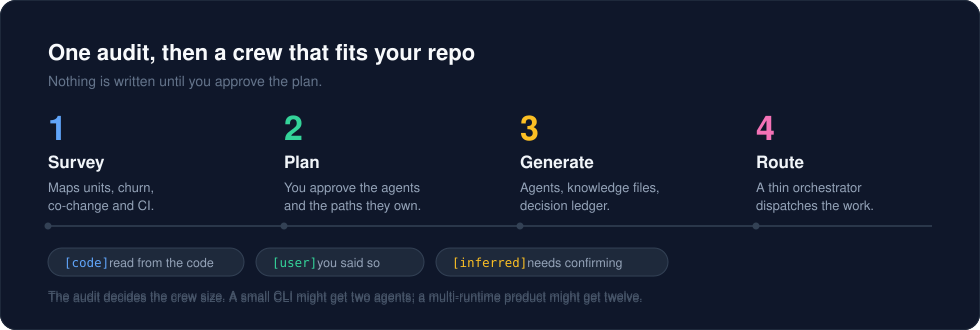
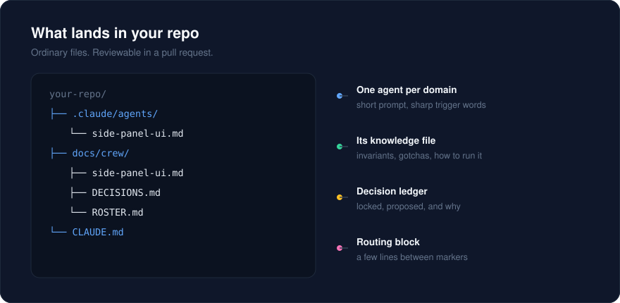

# repo-crew

**Your repo outgrew your AI's context window. Give it a team instead.**

`repo-crew` audits your codebase and generates a crew of specialist subagents, each owning a slice of the repo and starting every task from a committed knowledge file. The main conversation becomes a thin orchestrator that routes work instead of re-reading everything. Locked decisions live in a ledger that agents look up instead of "remembering".

The audit decides how many agents your repo needs. A small CLI might get two. A multi-runtime product might get a dozen. There is no fixed roster and no cap.

[](LICENSE)
[](https://github.com/suryanshgupta9933/repo-crew)



## The problem

AI-assisted coding makes a solo dev fast, until the project grows:

- No single session can hold the whole codebase.
- Decisions made three weeks ago get quietly contradicted.
- One giant CLAUDE.md is either too long to follow or too vague to help.
- Shipping steps (CI, PR, doc updates) depend on whether you remembered to ask.

## What you get



```
.claude/agents/<name>.md        one specialist per domain (short prompt, sharp router description)
docs/crew/<name>.md             committed knowledge per agent: invariants, gotchas, contracts, verify commands
docs/crew/shared/*.md           cross-cutting notes (architecture, data flow, stack) when several agents need them
docs/crew/DECISIONS.md          decision ledger: locked / proposed / superseded, with the why
docs/crew/ROSTER.md             who exists, what they own, why they exist
docs/crew/routing-evals.md      test prompts that check the orchestrator routes correctly
.crewignore                     globs for paths no agent owns on purpose
CLAUDE.md                       a short routing block between markers (idempotent updates)
```

See [`examples/sample-output`](examples/sample-output) for a trimmed illustration of a made-up project.

## Install

### Claude Code plugin

```bash
claude plugin marketplace add suryanshgupta9933/repo-crew
claude plugin install repo-crew@repo-crew-marketplace
```

Or from inside a session:

```
/plugin install repo-crew --marketplace suryanshgupta9933/repo-crew
```

### From source

```bash
git clone https://github.com/suryanshgupta9933/repo-crew.git
claude --plugin-dir ./repo-crew
```

### Any other AI tool

The skill follows the [Agent Skills](https://agentskills.io) standard: a `SKILL.md` with a standard frontmatter header, plus `references/` and `scripts/`. `skills/repo-crew/` is completely self-contained — nothing outside it — so it drops into any tool that reads Agent Skills or a `.claude/skills/` directory.

```bash
# into a project
git clone https://github.com/suryanshgupta9933/repo-crew.git
cp -r repo-crew/skills/repo-crew <your-project>/.claude/skills/repo-crew

# or into your user-level skills directory
cp -r repo-crew/skills/repo-crew ~/.claude/skills/repo-crew
```

Tools that read a project `AGENTS.md` (Codex, Aider, OpenCode and friends) can use the root [`AGENTS.md`](AGENTS.md), which points at the same skill.

One honest limitation: the generated agents are written to `.claude/agents/` with Claude Code frontmatter (`tools:`, `model:`), so the *output* targets Claude Code. The skill that produces it is portable; the crew it writes is Claude Code's shape.

### Uninstall

```bash
claude plugin uninstall repo-crew@repo-crew-marketplace
claude plugin marketplace remove suryanshgupta9933/repo-crew
```

## Use

In your project, just describe the problem:

> My repo is getting too big for one session and the AI keeps forgetting earlier decisions. Audit it and set up specialist agents.

The skill triggers on requests like that. Plugin skills are namespaced, so you can also invoke it explicitly as `/repo-crew:repo-crew`.

What happens:

1. **Survey.** A script maps units, size, recent churn, co-changing directories, CI and test signals, entry points. Claude then reads the code the numbers cannot explain.
2. **Crew plan.** You get a table of proposed agents with the reason each exists, plus what was merged away and why. Nothing is written yet.
3. **Interview.** One batch of questions for what code cannot tell it: decisions already locked, required CI commands, hard data/security rules, which of your installed skills should attach to which agent.
4. **Generate.** Agents, knowledge files, ledger, roster, CLAUDE.md block.
5. **Verify routing.** Test requests per agent, plus cross-domain and conflicting-with-a-decision cases.

Later modes: **audit** (do we still have the right agents?), **refresh** (knowledge drifted), **add** (new/split/merge/retire an agent).

## How it decides the crew

A candidate domain becomes an agent only if it passes all three tests:

| Test | Question |
|---|---|
| Ownership | Can you name the paths it owns? |
| Knowledge density | Does it have several non-obvious facts a fresh session would get wrong? |
| Traffic or blast radius | Is it touched often, or costly when wrong? |

Failures become sections in a neighbor's knowledge file or a shared note. Cross-cutting roles (docs/decisions keeper, shipper, reviewer, architect, security/privacy, QA, release) are included only when the repo gives a reason.

Details: [`skills/repo-crew/references/survey.md`](skills/repo-crew/references/survey.md) and [`core-roles.md`](skills/repo-crew/references/core-roles.md).

## Design choices worth knowing

- **Knowledge is committed files, not hidden memory.** Diffable, reviewable, shared with anyone who clones the repo, and checkable by script. Per-agent `memory:` fields can complement it but are not relied on.
- **Honesty tags.** Every non-obvious fact is tagged `[code]` (verified, with a path), `[user]` (you said so) or `[inferred]` (unverified). Inferred items are surfaced for you to confirm. Only you can lock a decision.
- **Least privilege.** Reviewers, architects and security agents are read-only by default.
- **Handoffs go through the orchestrator.** Subagents cannot spawn other subagents, so agents end with a structured `HANDOFF` block ("docs agent should update X") that the main conversation dispatches. If direct chaining becomes possible, keep the handoff block anyway for traceability.
- **Shipper discovers the gate, never invents it.** It derives required checks from your CI config and scripts, works on a branch, runs the same checks locally, opens a PR, and only merges if you say so.

## Keeping it fresh

The scripts live in the plugin, so run them from the repo you want to check:

```bash
python <plugin>/skills/repo-crew/scripts/survey_repo.py .                    # re-survey the repo
python <plugin>/skills/repo-crew/scripts/check_drift.py .                    # stale knowledge + uncovered paths
python <plugin>/skills/repo-crew/scripts/check_drift.py . --stamp docs/crew/<agent>.md   # after you reconcile a file
```

Exit code is nonzero when something is stale or when a path is covered by no knowledge file, so `check_drift.py` can run in CI. Paths that no agent owns on purpose go in `.crewignore` (one glob per line) so the uncovered report shows real gaps only. It also exits nonzero when there is no crew to check yet.

The uncovered report never mentions the crew's own artifacts (`docs/crew/`, `.claude/`, `.github/`), nor markdown and binary files — prose and assets are not path-ownership questions, so a repo's own `docs/*.md` stays out of the report. Anything else the repo ships is fair game for an agent to claim.

## Repo layout

```
.claude-plugin/
  plugin.json                 plugin manifest (name, version, author, license)
  marketplace.json            marketplace manifest, one entry sourced from "./"
skills/repo-crew/
  SKILL.md                    the skill itself
  references/                 progressive-disclosure detail (survey, roles, templates, ledger, maintenance)
  scripts/                    survey_repo.py, check_drift.py — standard library only
  evals/evals.json            example prompts with expected behaviour
examples/sample-output/       illustrative output for a made-up project
assets/                       diagrams used in this README
.github/workflows/            CI: manifest validation, script compile, version sync
```

## Status and limits

v0.1.1. The scripts are tested on small synthetic repos, and the full workflow has been run end to end against two real repositories of different shapes: a web app with a Python API and a Postgres backend, and a polyglot product with a browser extension, a service and a marketing site. Both runs produced a crew, a routing-eval file and a clean drift check, and neither touched the target repo's own source. Treat the first run on your own repo as a draft to review, not a finished system.

A full init run costs real tokens: on a ~230-file repository it takes roughly ten minutes and a few dollars of model spend, because the audit reads the code the survey cannot summarise. Audit and refresh are far cheaper — they work from the roster and from diffs against each file's `verified_at`. The survey script on its own is free and instant if you want to see the shape of the crew before committing to a full run.

Please open issues with the repo shape you tried and what the crew plan got wrong. Particularly useful: monorepos, polyglot repos, and repos that already have agents or ADRs.

Not in scope: running the agents for you, and supporting Claude Code features outside the plugin/skill surface.

## Prior art

Related projects worth a look: [fellowship-code](https://github.com/endaoment/fellowship-code) (a fixed cast of themed role agents with generated CLAUDE.md) and [claude-laravel](https://github.com/AratKruglik/claude-laravel) (a dispatcher-style setup for Laravel). repo-crew differs by deriving the crew from your repo's own structure, with committed per-domain knowledge, a decision ledger and drift detection.

## Contributing

Issues and PRs welcome — see [CONTRIBUTING.md](CONTRIBUTING.md). The short version: bump `version` in `.claude-plugin/plugin.json` and add a `CHANGELOG.md` entry, then run the checks.

## License

MIT — see [LICENSE](LICENSE).
